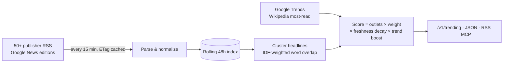

<div align="center">

# 🌍 FreeNews API

**A free news API for the world's top trending stories. No API key, no quotas.**

FreeNews follows 50+ major newsrooms and 20+ Google News editions. It groups articles about the same event and ranks stories by how many independent outlets are covering them right now.<br>
You can use the free hosted JSON with no server, or self-host the live API. It also works as a drop-in replacement for NewsAPI.org and includes an MCP server for AI agents.

[](https://github.com/Ethos6/free-news-api/actions/workflows/ci.yml)
[](https://github.com/Ethos6/free-news-api/releases)
[](https://ethos6.github.io/free-news-api/)
[](https://github.com/Ethos6/free-news-api/actions/workflows/feed-health.yml)
[](LICENSE)


**[Live demo](https://ethos6.github.io/free-news-api/)** · [Hosted API](#-option-1-free-hosted-api-zero-setup) · [Self-host](#-option-2-self-host-the-live-api) · [Endpoints](#-endpoints) · [How trending works](#-how-trending-works) · [NewsAPI drop-in](#-drop-in-replacement-for-newsapiorg) · [MCP](#-mcp-server-for-ai-agents)


<sub>Recorded automatically by the <a href="https://github.com/Ethos6/free-news-api/actions/workflows/demo.yml">Demo GIF workflow</a> with live feeds from a GitHub runner.</sub>

</div>

---

```bash
curl https://ethos6.github.io/free-news-api/v1/trending.json
```

```jsonc
{
  "updated_at": "2026-10-17T15:00:00Z",
  "stories": [
    {
      "title": "World leaders gather in Geneva for emergency climate summit",
      "url": "https://www.bbc.com/news/articles/…",
      "image": "https://ichef.bbci.co.uk/…jpg",
      "category": "world",
      "score": 9.41,
      "sources_count": 14,                        // independent outlets covering it
      "sources": ["BBC News", "Reuters", "The Guardian", "NPR", "…"],
      "countries": ["gb", "in", "us"],
      "keywords": ["geneva", "climate", "summit", "leaders"],
      "first_seen": "2026-10-17T08:12:00Z",
      "latest": "2026-10-17T14:51:00Z",
      "articles": [ { "title": "…", "url": "…", "source": { "name": "Reuters" }, "published_at": "…" } ]
    }
  ]
}
```

## Why?

| | Price | Limits | Trending detection | Open source |
|---|---|---|---|---|
| NewsAPI.org | free for development only, paid for production | 100 req/day on the free plan | ❌ | ❌ |
| GNews, Mediastack, NewsData… | paid tiers | daily or monthly caps | ❌ | ❌ |
| **FreeNews API** | **free** | **none imposed by the software** | ✅ cross-outlet clustering | ✅ **MIT** |

## ✨ Features

- **Real trending detection.** Headlines from every feed are grouped by weighted word overlap. Each story is scored by the number of distinct outlets, their editorial weight, freshness, and whether people are searching for it on Google Trends or reading about it on Wikipedia.
- **50+ publisher feeds**, including BBC, The New York Times, The Guardian, NPR, DW, Al Jazeera, France 24, CNBC, TechCrunch, The Verge, Ars Technica, ESPN, NASA and The Times of India.
- **23 Google News country editions × 8 topics.** Turn on the countries you want.
- **8 categories:** top, world, business, technology, science, health, sports, entertainment.
- **Trends:** Google Trends "trending now" by country, plus Wikipedia's most-read articles.
- **Search** your local index plus live Google News and Bing News results for any topic.
- **RSS output.** Every trending view is also available as an RSS feed.
- **Two ways to run it.** A free static API on GitHub Pages that updates every 30 minutes with no server, or a live self-hosted API.
- **NewsAPI.org-compatible** `/v2/top-headlines` and `/v2/everything`.
- **MCP server** for Claude Desktop, Cursor and Windsurf.
- **Polite fetching:** ETag/Last-Modified caching, a concurrency limit, and a configurable refresh interval.
- A **web UI**, OpenAPI docs at `/docs`, a CLI, Docker, API keys and rate limiting.

## 🆓 Option 1: Free hosted API (zero setup)

A GitHub Actions job rebuilds the API every 30 minutes and publishes plain JSON to GitHub Pages. It's served from a CDN with CORS enabled, so you can call it straight from a browser.

| URL (`https://ethos6.github.io/free-news-api/…`) | Content |
|---|---|
| `v1/trending.json` | Top 50 trending stories worldwide |
| `v1/trending/{category}.json` | Trending by category |
| `v1/countries/{cc}/trending.json` · `…/headlines.json` | By country: `us gb in au ca sg za ng` |
| `v1/headlines.json` · `v1/headlines/{category}.json` | Latest articles |
| `v1/trends.json` | Google Trends and Wikipedia most-read |
| `v1/feed.xml` · `v1/feed/{category}.xml` | RSS feeds of trending stories |
| `v1/sources.json` · `v1/meta.json` | Feed health and build info |

**Get your own copy in 2 minutes:** fork this repo, then go to *Settings → Pages → Source* and choose **GitHub Actions**. Run the *Free hosted API* workflow once. Your API is now at `https://<you>.github.io/free-news-api/`. To change countries or regions, edit the `env:` block in [`.github/workflows/pages.yml`](.github/workflows/pages.yml).

> GitHub pauses scheduled workflows in repos with no activity for 60 days. If that happens, re-enable the workflow with one click on the Actions tab.

## 🚀 Option 2: Self-host the live API

```bash
docker run -d -p 8000:8000 ghcr.io/ethos6/free-news-api:latest
# or
git clone https://github.com/Ethos6/free-news-api && cd free-news-api && docker compose up -d
# or
pip install "free-news-api[mcp] @ git+https://github.com/Ethos6/free-news-api"
freenews serve
```

Open `http://localhost:8000` for the UI or `/docs` for the API. The first refresh takes 20–40 seconds, and after that the feeds refresh every 15 minutes in the background.

**CLI:**

```bash
freenews trending -c technology -n 10
freenews headlines --country in -c sports
freenews search "electric vehicles"
freenews trends
freenews check                       # health table for every feed
freenews build --out site            # build the static API yourself
```

## 📡 Endpoints

| Endpoint | Description |
|---|---|
| `GET /v1/trending` | Trending stories. Params: `category`, `country`, `limit`, `hours` (look-back), `articles` (articles per story) |
| `GET /v1/headlines` | Latest articles. Params: `category`, `country`, `source`, `language`, `q`, `since`, `limit`, `page` |
| `GET /v1/search?q=` | Local index plus live Google News and Bing News |
| `GET /v1/trends?geo=US` | Google Trends and Wikipedia most-read |
| `GET /v1/feed.xml` | Trending stories as RSS (`category`, `country`) |
| `GET /v1/sources` | Every feed with live health status |
| `GET /v1/categories` | Categories and supported countries |
| `POST /v1/refresh` | Refresh now |
| `GET /health` | Liveness, last update time, article count |

## 🔁 Drop-in replacement for NewsAPI.org

Change `https://newsapi.org` to your server and keep your code:

```python
requests.get("http://localhost:8000/v2/top-headlines", params={"country": "us", "category": "business"})
requests.get("http://localhost:8000/v2/everything", params={"q": "bitcoin", "pageSize": 20})
```

The response format matches NewsAPI.org exactly (`status`, `totalResults`, and `articles[]` with `source`, `author`, `title`, `description`, `url`, `urlToImage`, `publishedAt`, `content`). `apiKey`, `X-Api-Key` and `Authorization: Bearer` are all accepted.

## 🤖 MCP server for AI agents

```json
{ "mcpServers": { "freenews": { "command": "freenews", "args": ["mcp"] } } }
```

This gives your assistant four tools: `trending_news`, `latest_headlines`, `search_news` and `trending_searches`. For remote agents, use `freenews mcp --transport streamable-http`.

## 🧠 How trending works



1. **Normalize.** Every item becomes an article with a title, URL, description, image, publisher, category, country and a UTC date. Tracking parameters are stripped, and duplicates are merged.
2. **Cluster.** Headline words are weighted by rarity (IDF). Two headlines join the same story when the rare words they share make up at least 50% of the shorter headline's total weight.
3. **Score.** Each story's score is the sum of its distinct outlets' editorial weights, plus Google News' own "related coverage" count, times a freshness decay with an 8-hour half-life. Stories matching a Google Trends term or a top Wikipedia article get a ×1.5 boost. One outlet counts once, so `bbc.com` and `bbc.co.uk` are the same outlet.
4. **Pick a representative.** The story's headline and link come from a direct publisher article with an image and description where possible.

## ⚙️ Configuration

See [`.env.example`](.env.example). The most useful settings are:

| Variable | Default | |
|---|---|---|
| `FREENEWS_COUNTRIES` | `us,gb,in,au,ca` | Google News editions (23 available) |
| `FREENEWS_TREND_GEOS` | `US,GB,IN` | Google Trends regions |
| `FREENEWS_REFRESH_MINUTES` | `15` | Poll interval |
| `FREENEWS_TRENDING_WINDOW_HOURS` | `24` | Trending look-back |
| `FREENEWS_HALF_LIFE_HOURS` | `8` | Freshness decay |
| `FREENEWS_DISABLED_SOURCES` | – | Source ids to skip |
| `FREENEWS_EXTRA_SOURCES` | – | JSON file of your own feeds |
| `FREENEWS_API_KEYS` / `FREENEWS_RATE_LIMIT` | – / `0` | Protect a public server |
| `FREENEWS_SNAPSHOT` | – | File that keeps the index across restarts |

**Adding a source:** add one line to [`freenews/sources.py`](freenews/sources.py), or list your feeds in a JSON file and point `FREENEWS_EXTRA_SOURCES` at it.

## ♾️ What "free and unlimited" means

- **No quotas in the software.** Your server, your rules.
- **The hosted API is static files on a CDN,** so there are no per-request limits.
- **Light on publishers.** FreeNews reads the public RSS feeds that publishers provide for syndication. It uses one request per feed per refresh, no matter how many people call your API.

## ⚖️ Content and fair use

FreeNews returns **headlines, short summaries and links** that come from the publishers' own RSS feeds. It never copies full articles, and every result links to the original publisher. Article content belongs to its publishers. Check each publisher's feed terms before any commercial use. Google News items link through `news.google.com` redirect URLs.

## 🛠 Development

```bash
pip install -e ".[dev]"
pytest            # offline, fixture-based
ruff check .
freenews check    # live feed health from your machine
```

PRs are welcome, especially new regional feeds, non-English sources and better clustering.

## 📄 License

[MIT](LICENSE). If this saves you a news API bill, **please ⭐ star the repo**.

See also: [FreeSearch API](https://github.com/Ethos6/free-search-api), a free self-hosted web search API.
